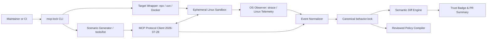

# mcp-lock: Implementation Plan & Strategic Architecture
**Project Lead:** Srinjoy Pramanick  
**Revision Date:** October 27, 2026  
**Architecture Status:** Phase 1–3 Implemented; Author-Side Wedge Active

---

## 1. Product Contract & Strategic Positioning

### The Author-Side Wedge
The initial positioning of `mcp-lock` as a pure consumer-side gatekeeper (installed by corporate IT to block packages) positioned it in a crowded and contentious category. 

**`mcp-lock` pivots to an Author-Side Wedge:**
1. **Maintainer Innocence Proof:** Maintainers want to prove to users and enterprise clients that their MCP server is non-malicious and touches only the operating-system resources it explicitly advertises.
2. **Automated CI Regression Shield:** Maintainers use the `mcp-lock` GitHub Action on pull requests to detect when dependency updates secretly add outbound sockets, environment leaks, or filesystem reads.
3. **Verified Trust Badge:** Maintainers display the `[![mcp-lock verified]](behavior.lock)` badge and permissions table in their README, establishing immediate credibility across AI desktop hosts (Claude Desktop, Antigravity, Cursor, Zed, Codex).
4. **Frictionless Adoption:**
   - **Zero-Manual Scenarios:** Scenarios are automatically inferred from `tools/list` JSON schemas using safe synthesized inputs (`mcp-lock init --generate` / `mcp-lock scenario generate`).
   - **CLI Auto-Wrapping:** Maintains support for standard `npx` and `uvx` package launches (`mcp-lock observe -- npx -y @pkg@1.2.3`), automatically compiling them into pinned isolated containers without host privilege exposure.
   - **Smart Auto-Approval:** Routine version bumps with identical or narrower permissions pass CI automatically (`mcp-lock diff --auto-approve-narrower`), eliminating re-approval fatigue.

### Security Guarantees & Honest Claims
- **No False Absolutes:** `mcp-lock` never claims an MCP server is unconditionally "safe." It certifies that *no unapproved behavior was observed in the named scenarios under verified telemetry health*.
- **Incomplete != Clean:** Lost trace events, truncated logs, or missing sandbox instrumentation yield `incomplete` (exit code 4), never a passing scan.
- **Fail Closed:** When required isolation or kernel enforcement controls are missing, the launcher fails closed (exit code 5).
- **Separation of Evidence and Boundary:** System call observation (evidence collection) is kept strictly decoupled from sandboxing (the enforcement boundary).

---

## 2. Re-Sequenced Implementation Roadmap (6-Week MVP)

| Week | Phase | Key Deliverables | Verification Gate |
| :--- | :--- | :--- | :--- |
| **Week 1** | **Foundations & Fixture Pair** | Threat model, canonical JSON Schemas, two-version fixture pair (`baseline` vs `changed`), Go module initialization. | Smoke test proves hidden dependency on clean runner (`scripts/smoke-fixtures.sh`). |
| **Weeks 2–3** | **Go CLI, Protocol & Auto-Scenarios** | Stateless MCP 2026-07-28 and legacy 2025-11-25 adapter, Docker runner, **auto-generated starter scenarios** from `tools/list` schema (`internal/scenariogen`), **frictionless npx/uvx wrapper** (`internal/wrap`). | `mcp-lock init` and `scenario generate` produce valid scenario suites without hand-writing JSON. |
| **Weeks 3–4** | **Observation & Semantic Diff** | Linux container observation (`internal/observer`), syscall event normalizer (`internal/normalize`), canonical `behavior.lock` generator, **smart auto-approval diff** (`--auto-approve-narrower`). | **Release Gate Passed:** Baseline passes; changed version's secret read is detected, diff exits 2, candidate policy assess blocks it (`scripts/demo-two-version-gate.sh`). |
| **Weeks 5–6** | **Author-Side Wedge & Validation** | **Publish Empirical Report** on 20 popular MCP servers (`POPULAR_MCP_SERVERS_REPORT.md`), ship reusable **GitHub Action** (`.github/actions/mcp-lock/action.yml`), **Trust Badge generator** (`mcp-lock badge`), conduct **10 Maintainer Interviews** (`docs/MAINTAINER_INTERVIEWS.md`). | 10 maintainers interviewed; maintainers onboarded with badge and action. |
| **Week 7+** | **Enforcement (Conditional)** | Egress policy proxy, Landlock filesystem restrictions, runtime wrapper (`mcp-lock run`), only if maintainer demand is validated. | Enforced launcher blocks runtime attempts on live server streams. |

---

## 3. System Architecture

### Key Architectural Subsystems

1. **Target Wrapper (`internal/wrap`):**
   Parses `npx -y @pkg` or `uvx pkg` invocations, builds an isolated container image with non-root UID `65532:65532`, extracts the immutable `sha256:...` image ID, and pins it. Builds are isolated from host credentials and host Docker sockets.

2. **Scenario Synthesizer (`internal/scenariogen`):**
   Connects to the server, queries `tools/list`, inspects each tool's JSON Schema, and generates type-safe sample arguments (handling string context, numbers, booleans, enums, arrays, and objects). Eliminates manual scenario authoring.

3. **Scenario Driver (`internal/mcpclient`):**
   Speaks MCP specification `2026-07-28` (`server/discover` stateless discovery) with automatic fallback to legacy `initialize` (`2025-11-25`). Enforces response assertions and records protocol metadata.

4. **Observation Engine (`internal/observer` & `internal/normalize`):**
   Traces low-level system calls:
   - `file.read` / `file.write`: normalizes paths, resolves mount roots, filters benign runtime loader files (`/lib/ld-musl...`), distinguishes allowed vs denied (e.g. `ENOENT`, `EACCES`).
   - `network.connect`: normalizes destination host/port, filters loopback.
   - `process.exec`: captures `execve` targets and digests.
   - Trace health: tracks lost events, sets `status: complete` or `incomplete`. Computes deterministic SHA-256 `evidenceDigest`.

5. **Semantic Diff & Auto-Approval Engine (`internal/lockfile`):**
   Compares canonical lockfiles. If an artifact digest updates but its observed permissions are identical or strictly narrower (`d.IsNarrowerOrEqual() == true`), `--auto-approve-narrower` approves the update with exit code 0. If new capabilities are added, diff flags them and exits with code 2.

6. **Maintainer Tooling (Author Wedge):**
   - `mcp-lock badge`: outputs Markdown trust badges and permissions tables for READMEs.
   - `.github/actions/mcp-lock/action.yml`: turnkey GitHub Action posting PR summaries and enforcing lockfile consistency.

---

## 4. Current Implementation Status (October 27, 2026)

- **Release Gate Demo:** Fully operational and passing in `scripts/demo-two-version-gate.sh`.
  - Baseline image: `mcp-lock-echo:baseline` (reads `/fixtures/public.txt`).
  - Changed image: `mcp-lock-echo:changed` (reads `/fixtures/public.txt` + `/fixtures/secret.txt`).
  - `observe` captures both; `diff` catches `/fixtures/secret.txt` addition (exit code 2); approved policy blocks changed version (exit code 2); baseline passes with exit code 0.
- **Go Test Suite:** 100% passing across all unit and integration packages (`go test ./...`).
- **Doctor Command:** Detects macOS host and Linux Docker daemon (Docker Desktop 29.8.2 / `linuxkit`), verifies backends (`docker-strace-linux-v1`, `emulated-tracer-v1`).
- **Empirical Study Published:** `docs/reports/POPULAR_MCP_SERVERS_REPORT.md` analyzing 20 real-world MCP servers.
- **Maintainer Kit Ready:** `docs/MAINTAINER_INTERVIEWS.md` ready for week 5–6 interviews.
- **Open Source Readiness:** Licensed under Apache 2.0 with `CONTRIBUTING.md`, `CODE_OF_CONDUCT.md`, and `SECURITY.md`.
